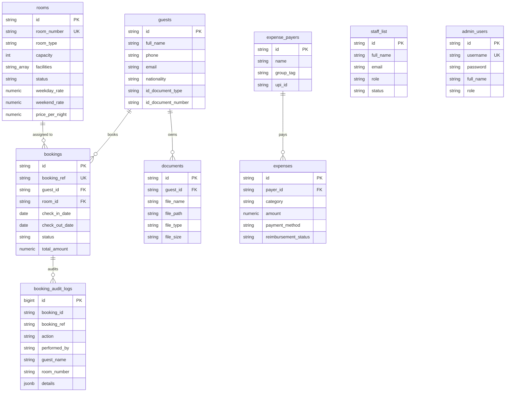

# Somajam Holidays, Parunthumpara — Staff Operations & Management Portal

> A high-performance, full-featured internal operations and property management system built for **Somajam Holidays**, located in Parunthumpara, Peerumedu, Idukki, Kerala ([somajamholidays.com](https://somajamholidays.com/)). Engineered to manage 5 1BHK cottages, dynamic weekday/weekend rates, multi-room bookings, interactive monthly calendar occupancy, rapid phone & walk-in check-in/out workflows, document compliance archives with in-app previews, date-wise regulatory police registers, 1-click monthly ZIP archive bundles with free-tier cloud storage reclamation, multi-director expense settlement ledgers, and role-based staff administration.

---

## 1. App Identity & Property Overview

* **App Name:** Somajam Holidays Staff Operations Portal
* **Official Website:** [https://somajamholidays.com/](https://somajamholidays.com/)
* **Property Location:** Parunthumpara, Otappalam, Peerumedu, Idukki, Kerala - 685537
* **Property Facilities:** 5 1BHK Cottages, Swimming Pool Access, Free High-Speed Wi-Fi, Dedicated EV Charging Station, Purified Drinking Water, Outdoor Grilling Facilities, Campfire Zone with Audio System, Drivers' Lounge.
* **Core Purpose:** An integrated internal operations portal for front-desk staff, property caretakers, and owner/directors to manage cottage inventory (`No. 1` to `No. 5`), record bookings, execute instant check-in/out workflows, archive guest ID compliance proofs, track multi-account expenses across Directors & Caretaker, generate regulatory police guest registers, monitor occupancy analytics, and manage cloud storage quotas.

---

## 2. Cottage Inventory & Dynamic Pricing (5 1BHK Cottages)

The property operates **5 dedicated 1BHK Cottages** numbered **No. 1** through **No. 5**, each equipped with dedicated amenities and configured with dynamic **Weekday vs Weekend** rates:

* **Weekday Nights:** Sunday through Thursday nights
* **Weekend Nights:** Friday and Saturday nights

| Cottage | Type | Capacity | Key Facilities & Highlights | Weekday Rate (Sun–Thu) | Weekend Rate (Fri–Sat) |
| :--- | :--- | :---: | :--- | :---: | :---: |
| **No. 1** | 1BHK Cottage | 4 Guests | Swimming Pool Access, Free Wi-Fi, EV Charging, Kitchenette, Audio System, Grilling Area | ₹3,500 / night | ₹4,500 / night |
| **No. 2** | 1BHK Cottage | 4 Guests | Swimming Pool Access, Free Wi-Fi, EV Charging, Kitchenette, Valley View Patio, Campfire Zone | ₹3,500 / night | ₹4,500 / night |
| **No. 3** | 1BHK Cottage | 4 Guests | Swimming Pool Access, Free Wi-Fi, EV Charging, Kitchenette, Private Balcony, Hot Water Shower | ₹3,500 / night | ₹4,500 / night |
| **No. 4** | 1BHK Cottage | 4 Guests | Swimming Pool Access, Free Wi-Fi, EV Charging, Kitchenette, Drivers' Lounge Access, Audio System | ₹3,500 / night | ₹4,500 / night |
| **No. 5** | 1BHK Cottage | 5 Guests | Swimming Pool Access, Free Wi-Fi, EV Charging, Full Kitchen, Campfire Area, Mountain View | ₹4,000 / night | ₹5,000 / night |

*Rates, capacities, and amenity tags are fully editable in real-time by administrators via the Cottage Inventory screen (`RoomModal.jsx`).*

---

## 3. Comprehensive Feature Suite

### 🔐 1. Authentication & Multi-Role Security
* **Dedicated Login Screen (`/login`)**: Secure credential barrier protecting guest PII, identity documents, and financial transactions.
* **Role-Based Access Control (RBAC)**:
  * **Admin / Owner**: Full system permissions. Username `admin` (or `somajam`) with password `somajam2026`. Can modify cottage rates, delete guest records, manage staff accounts, and purge cloud storage.
  * **Caretaker**: Operations and ground-management role. Username `caretaker` with password `caretaker2026`. Can check in/out guests, log maintenance, track expenses, and view calendar schedules. Displays a distinct amber badge in the top navigation bar.
  * **Staff**: Front-desk operations role for handling reservations and daily arrivals.
* **Supabase `admin_users` Authentication**: Optional persistent credentials verification against the database with fallback to encrypted session storage.
* **Persistent Sessions**: State preserved across page reloads in `localStorage` (`somajam_auth` & `somajam_user`).
* **Header Sign-Out & Live Clock**: Instant session termination from the top navigation bar along with real-time date/time display.
* **Crash-Resilient Error Boundary**: Top-level React Error Boundary that isolates uncaught runtime errors and provides a 1-click **"Reset Session & Sign In"** button to recover instantly without data loss.

---

### ⚡ 2. Two-Tier Booking & Multi-Room Reservations (`BookingModal.jsx`)
To accommodate advance phone inquiries, multi-room group stays, and walk-in arrivals, the **Create Booking** modal offers two operational modes:

#### ⚡ Mode A: "Quick Booking" (Advance Phone Inquiries)
* **Goal**: Capture phone inquiries in under 15 seconds.
* **Fields**: Guest Full Name `*`, Mobile / Phone Number `*`, Cottage Selection (single or multi-cottage), Check-In & Check-Out dates, Guest Count, Staff Notes.
* **Repeat Guest Recognition**: Entering a returning guest's phone number automatically recognizes their profile, pre-populates their name, and displays their previous booking count badge.
* **Outcome**: Registers or merges the guest profile with ID marked as `Pending Check-In ID` and creates a **Confirmed** reservation. Detailed ID proofs can be captured later upon physical arrival.

#### 📋 Mode B: "Detailed Booking & Instant Check-In" (Walk-Ins & Immediate Arrivals)
* **Goal**: Register guest details, verify government ID, upload document scans, assign cottage, and check in walk-in guests **in a single form submission**.
* **Guest Entry Flexibility**:
  * 🟢 **New Walk-In Guest**: Captures Full Name, Phone, Email, Address, Nationality, ID Document Type (Aadhaar, Passport, Voter ID, Driver's License), and ID Number.
  * 🔵 **Existing Guest Directory**: Quick-select from returning guests to auto-populate contact details.
* **Multi-Room Group Booking Support**: Front-desk staff can select multiple cottages simultaneously (e.g. `No. 1` and `No. 2`). The system automatically:
  * Checks non-overlapping availability for each room individually.
  * Generates indexed booking reference numbers (e.g. `SJM-2026-001-A`, `SJM-2026-001-B`).
  * Calculates aggregated stay pricing across all selected cottages.
* **Dynamic Stay Pricing Engine (`pricing.js`)**: Real-time stay calculation breaking down the stay into weekday nights vs weekend nights with rate transparency.
* **Multi-File Document Drop Zone**: Attach and stage multiple ID photos/scans (Passport, Aadhaar front/back) simultaneously with size validation.
* **Instant Status Switch**:
  * `🔘 Instant Check-In & Mark Occupied` (Default for walk-ins)
  * `🔘 Confirmed (Upcoming)`
* **Outcome**: Atomically creates/merges the guest record, uploads ID files to Supabase Storage, creates the booking record(s), and marks the assigned cottage(s) **Occupied** in one click.

---

### 🛎️ 3. Operations Dashboard (`/`)
* **Property Command Center**: Real-time front desk summary designed for desktop, tablet, and mobile browsers.
* **Welcome Banner & Quick Triggers**: 1-click triggers for `+ Add Booking`, `+ Add Guest`, and `Upload ID Doc`.
* **Live Operational Metrics**:
  * **Today's Check-Ins**: Confirmed arrivals scheduled specifically for today.
  * **Today's Check-Outs**: Occupied cottages scheduled to depart today.
  * **Occupied Rooms & Occupancy Rate %**: Real-time meter (e.g. 2/5 cottages occupied = 40.0%).
  * **Available Rooms Count**: Instant view of cottages ready for new walk-ins.
* **Arrivals Action Queue**: List of arriving guests with warning indicators for missing ID proofs and a 1-click `Check In` trigger.
* **Departures Action Queue**: List of departing guests with room numbers, stay dates, and a 1-click `Check Out` trigger.
* **Upcoming Reservations Queue**: Chronologically sorted list of confirmed future bookings with 1-click cancellation.

---

### 👥 4. Guest Directory & Compliance Archives (`/guests`)
* **Live Instant Search**: Search across Guest Name, Phone Number, Nationality, and ID Document Number.
* **Document Compliance Filter**:
  * `All Guests`
  * `Has ID Uploaded` (Compliant profiles)
  * `Missing ID Document` (Flags profiles needing arrival documentation)
* **Unified Add / Edit Guest Modal (`GuestModal.jsx`)**: Comprehensive form for personal contact info, nationality, ID details, notes, plus optional 1-step room booking.
* **Interactive Guest Detail Drawer**: Clicking any guest opens an extensive 3-tab sliding drawer:
  1. **Personal Details**: Contact information, permanent residential address, nationality, and ID classification.
  2. **Stay History**: All past and active reservations, booking references (`SJM-2026-xxx`), assigned cottages, dates, and stay statuses.
  3. **Document Archives**: List of all uploaded ID documents with file size, upload timestamp, and 1-click triggers to preview in-app or download.
* **Shortcut to Monthly Archives**: Direct header navigation to the Monthly Visitor Archive & Storage Manager.
* **Admin-Only Delete**: Admin users can delete guest records (with cascade cleanup of linked bookings).

---

### 📅 5. Bookings Hub, Calendar & Audit Trail (`/bookings`)
* **Dual View Modes (List Table vs Monthly Calendar)**:
  * 📋 **List / Table View**: Filterable table of reservations with booking ref, guest name, assigned room, stay dates, pricing badge, person count, and status badge.
  * 🗓️ **Interactive Monthly Calendar View (`MonthlyCalendarView.jsx`)**:
    * Full 7-day grid showing day-by-day room occupancies.
    * Month navigation (`Previous Month` / `Next Month`) and `Today` quick jump.
    * Cottage dropdown filter (`All Cottages (5)` or specific cottage).
    * Visual color-coded stay pills (Emerald for Checked In, Sky for Confirmed, Slate for Checked Out).
    * Click any reservation in the calendar to open a detailed modal with instant **Check In**, **Check Out**, or **Cancel** actions.
* **Status Filter Tabs**: Quick-filter tabs with dynamic counters (`All`, `Upcoming`, `Checked In`, `Checked Out`, `Cancelled`).
* **Cottage Dropdown Filter**: Filter reservations specifically for `No. 1`, `No. 2`, `No. 3`, `No. 4`, or `No. 5`.
* **Search Filter**: Search by booking reference ID (`SJM-2026-xxx`), guest name, or room number.
* **Double-Booking Prevention Guard**: Algorithmically validates that the selected cottage has no conflicting reservations (`new_check_in < existing_check_out AND new_check_out > existing_check_in`).
* **Booking Activity & Audit Log Modal (`BookingAuditModal.jsx`)**:
  * Comprehensive chronological audit trail of all booking actions:
    * `CREATED` (New booking created)
    * `CHECKED_IN` (Guest check-in processed)
    * `CHECKED_OUT` (Guest departure recorded)
    * `CANCELLED` (Reservation cancelled)
  * Records the acting user (`Somajam Admin`, `Property Caretaker`, or `Staff`), timestamp, guest name, and cottage number.
  * Filterable by action type (`ALL`, `CREATED`, `CHECKED_IN`, `CHECKED_OUT`, `CANCELLED`) and searchable by booking ref or guest name.
  * Real-time count badge displayed on the Bookings page header button.
* **Interactive Check-In Modal (`CheckInModal.jsx`)**:
  * Displays booking and guest summary.
  * ID Compliance Warning banner if ID was pending during phone booking.
  * In-place ID Type, ID Number, and multi-file document upload fields with thumbnail preview cards.
  * Automatically uploads files to Supabase Storage, links records to database, marks ID verified, and transitions room status to `Occupied`.
* **Interactive Check-Out Modal (`CheckOutModal.jsx`)**:
  * Displays stay duration and billing summary.
  * Room inspection checklist ("Room inspected & key returned by guest").
  * Staff departure notes field.
  * Automatically transitions booking status to `Checked Out` and cottage status back to `Available`.
* **Cancel Reservation**: Staff can cancel upcoming reservations with confirmation and toast feedback.

---

### 🏡 6. Cottage Inventory, Dynamic Rates & Amenities (`/rooms`)
* **Real-Time Visual Grid**: Detailed cottage cards for `No. 1` through `No. 5`.
* **Dual Rates Display**: Clear weekday vs weekend pricing cards for every cottage (`Sun–Thu night` vs `Fri–Sat night`).
* **Occupant Banner**: When a cottage is `Occupied`, an occupant banner appears displaying the current guest's name and their scheduled check-out date.
* **Maintenance Workflow**:
  * 1-Click `Mark Maintenance` button to temporarily pull a cottage out of inventory for repairs, cleaning, or pool servicing.
  * 1-Click `Set Available` button to return the cottage to active inventory.
* **Cottage Configuration & Edit Modal (`RoomModal.jsx`)**:
  * Admin-only modal to **create new rooms** or **edit existing cottages**.
  * Adjust cottage name/number, category, and guest capacity.
  * Configure specific **Weekday Rate** and **Weekend Rate**.
  * Amenities Manager: Select from standard facilities (Swimming Pool Access, EV Charging, Wi-Fi, Kitchenette, Patio, Campfire, Hot Shower, AC, etc.) or type and add custom amenity tags.

---

### 💰 7. Multi-Account Expense Tracker & Settlement Ledger (`/expenses`)
* **Multi-Payer Partnership Ledger**: Built specifically for Somajam Holidays' partnership structure consisting of **5 Directors**, **1 Caretaker**, and a **Common Homestay Account**.
* **Financial Metric Cards**:
  * **Total Outlay Logged**: Cumulative expenditure recorded across all accounts.
  * **Common Pool Outlay**: Expenses paid directly from the common homestay account.
  * **Directors Outlay**: Cumulative out-of-pocket spending funded by the 5 Directors.
  * **Total Pending Reimbursements**: Outstanding out-of-pocket money owed back by the homestay.
* **Live Reimbursement Settlement Summary**: Live calculation alert showing the exact out-of-pocket amounts owed back to each individual Director or Caretaker.
* **Payer Filter Tabs**: Filter transactions by `All Accounts`, `Common Homestay Account`, `Director 1 (Ramesh)`, `Director 2 (Sarah)`, `Director 3 (George)`, `Director 4 (Anish)`, `Director 5 (Deepa)`, `Caretaker (Joy)`, or custom accounts.
* **Multi-Filter & Search Bar**: Filter by expense category (`Utilities`, `Maintenance`, `Staff Wages`, `Guest Amenities`, `Food & Kitchen`, `Govt Taxes`, `Miscellaneous`), payment method (`UPI`, `Cash`, `Bank Transfer`, `Card`), and reimbursement status (`Settled` vs `Pending Reimbursement`).
* **1-Click Settlement Toggle**: Click any badge in the table to toggle an expense between `Pending Reimbursement` and `Settled` instantly.
* **Log & Edit Expense Modal (`ExpenseModal.jsx`)**: Record date, payer account, category, amount, payment method, description, and attach bill/receipt scans.
* **Manage Accounts Modal (`ManagePayersModal.jsx`)**: Add custom expense accounts/directors/vendors with category tag, contact phone, and UPI ID.
* **Strict Safety & Authorization Rules**:
  * **Account Deletion Safety Rule**: Blocks deleting any account that has active transactions linked to it.
  * **Transaction Deletion Authorization**: Only the user recorded on that specific transaction (matching the active user identity selector) is authorized to delete it.
* **Dual Persistence Sync**: Transactions and accounts synchronize automatically to both `localStorage` (`somajam_expenses`, `somajam_expense_payers`) and Supabase DB.

---

### 📊 8. Analytics, Regulatory Registers, Archives & Storage Manager (`/reports-settings`)
The Reports & Settings hub provides **5 dedicated operational tabs**:

#### 📋 Tab 1: Date-Wise Guest Register (`guest_register`)
* **Regulatory Compliance**: Built to fulfill Kerala Tourism and local police guest register mandates.
* **Flexible Date Filters**: Date range picker (Start Date to End Date) with 1-click presets:
  * `Today`
  * `Last 7 Days`
  * `This Month`
  * `All Stays`
* **Cottage & Status Filters**: Filter by cottage number (`No. 1` to `No. 5`) and booking status (`Confirmed`, `Checked In`, `Checked Out`).
* **Instant Search**: Search by guest name, phone, booking ref, room, or ID number.
* **In-Table Document Preview**: 1-click `View ID` button opens the verified guest document scan.
* **1-Click Export Date-Wise CSV**: Generates an exhaustive CSV ledger (`Somajam_Guest_Register_<dates>.csv`) with Sl No, dates, nights, booking ref, room, guest contact, residential address, nationality, ID type, ID number, person count, status, and staff notes.
* **Printable Register**: Formatted `window.print()` layout ready for physical inspection or file presentation.

#### 🗄️ Tab 2: Monthly Visitor Archive & Free-Tier Storage Manager (`monthly_archive`)
* **Supabase Free-Tier Storage Barometer**: Visual progress bar tracking actual storage used vs the 1,000 MB (1 GB) Supabase free-tier limit, along with total document count.
* **Month & Year Selector**: Select any month and year to inspect historical visitors, bookings count, attached ID files count, and data weight.
* **1-Click Download Monthly Archive (.ZIP) (`archiveExporter.js`)**:
  * Bundles the entire month's data into a standalone, compressed `.ZIP` file (`Somajam_Visitors_Archive_YYYY_MM_Month.zip`) containing:
    1. `visitors_register_YYYY_MM.csv`: Detailed visitor log with phone, address, stay dates, and cottage numbers.
    2. `police_guest_register_YYYY_MM.csv`: Official Form C / Indian homestay police station ledger format.
    3. `id_documents/`: Folder containing high-resolution copies of all scanned Aadhaar cards, passports, and driver's licenses.
    4. `ARCHIVE_SUMMARY.txt`: Machine-readable summary manifest with totals and timestamps.
  * Visual badge confirms when an archive has been downloaded and saved locally.
* **Free Up Cloud Storage / Storage Purge Tool (`purgeMonthStorage`)**:
  * Admin-only tool to safely purge heavy image files from Supabase Storage for the archived month once downloaded to local backup.
  * Reclaims cloud storage space while keeping database metadata and local ZIP backups intact.
  * Includes a confirmation dialog with warning protections.

#### 📈 Tab 3: Occupancy Analytics (`reports`)
* Live property occupancy rate gauge.
* Total completed stays hosted counter.
* Total registered guests counter.
* Cottage-by-cottage occupancy breakdown bars (utilization for No. 1 to No. 5).
* 1-Click **Export CSV** for monthly occupancy metrics.

#### 📜 Tab 4: Historical Stays & Cancellation Logs (`history`)
* Comprehensive historical archive of all completed guest stays and cancelled bookings.
* Filterable log showing Booking Ref, Guest Name, Room, Check-in/Out dates, and final status.
* 1-Click **Export CSV** for hospitality tax, audit, and local police reporting.

#### 👥 Tab 5: Staff Directory & Administration (`staff`)
* Directory of internal staff members showing Name, Email, Phone, Role (`Admin`, `Caretaker`, `Staff`), Designation Title, and Status (`Active`).
* Admin-only **+ Add Staff Member** modal to register new front-desk employees.

---

### 📁 9. In-App Document Storage & Multi-Format Viewer (`DocumentViewerModal.jsx`)
* **Embedded Preview Modal**: High-performance in-app modal that previews ID scans and receipts without needing external PDF reader extensions.
* **Supported Media Formats**:
  * Image Scans: `.jpg`, `.jpeg`, `.png`, `.webp`, `.gif`, `.bmp`
  * Documents: `.pdf`
  * Staged Camera/Upload files: Real-time object URLs generated via `URL.createObjectURL`
  * Base64 & Supabase Storage remote URLs
* **Compliance Download Button**: 1-click trigger to download original files for police verification or accounting compliance.
* **Dedicated Upload Modal (`DocumentUploadModal.jsx`)**: Direct ID document uploader from the dashboard to attach Passport, Aadhaar, Voter ID, or Driver's License scans to any guest profile.

---

### 🖼️ 10. Client-Side Image Compression Utility (`imageCompressor.js`)
* **Automatic Downscaling**: Compresses heavy 3–8 MB camera photos down to 150–300 KB client-side before sending to Supabase Storage.
* **Canvas Processing**: Scales maximum width/height to 1600px while maintaining original aspect ratios and JPEG quality.
* **Bandwidth & Storage Optimization**: Drastically speeds up uploads on rural mobile data networks in Parunthumpara and preserves Supabase free-tier storage limits.

---

## 4. User Roles & Permissions Matrix

The portal supports **3 User Roles** (strictly internal staff-only access):

| Feature / Action | Staff | Caretaker | Admin / Owner |
| :--- | :---: | :---: | :---: |
| **Login with Credentials / Auto-Fill** | ✅ | ✅ | ✅ |
| **View Dashboard & Live Operational Metrics** | ✅ | ✅ | ✅ |
| **Search & View Guest Profiles & Archives** | ✅ | ✅ | ✅ |
| **Create Booking (Quick & Detailed Modes)** | ✅ | ✅ | ✅ |
| **Multi-Room Group Booking Creation** | ✅ | ✅ | ✅ |
| **View Monthly Calendar Occupancy Grid** | ✅ | ✅ | ✅ |
| **View Booking Activity Audit Logs** | ✅ | ✅ | ✅ |
| **Attach & Preview Guest ID Documents** | ✅ | ✅ | ✅ |
| **Process Check-In & Check-Out Workflows** | ✅ | ✅ | ✅ |
| **Cancel Upcoming Bookings** | ✅ | ✅ | ✅ |
| **Toggle Cottage Maintenance Status** | ✅ | ✅ | ✅ |
| **Log & Settle Expenses / View Ledgers** | ✅ | ✅ | ✅ |
| **Export Date-Wise Guest Register CSV** | ✅ | ✅ | ✅ |
| **Download Monthly Visitor ZIP Archive** | ✅ | ✅ | ✅ |
| **Delete Guest Profile (with Cascade)** | ❌ | ❌ | ✅ |
| **Add / Edit Cottage Inventory & Base Rates** | ❌ | ❌ | ✅ |
| **Manage / Add Staff Accounts** | ❌ | ❌ | ✅ |
| **Purge Cloud Storage / Free Up Quotas** | ❌ | ❌ | ✅ |
| **Export Analytics & Stay Records to CSV** | ❌ | ❌ | ✅ |

---

## 5. Screen Directory & Route Mapping

The application is structured into **7 responsive screens**:

| Route | Screen Name | Key Components & Modals |
| :--- | :--- | :--- |
| `/login` | **Authentication Portal** | Secure login form, default credentials auto-filler, role detection (`admin`, `caretaker`), brand styling |
| `/` | **Operations Dashboard** | Metrics cards, Arrivals queue, Departures queue, Upcoming bookings queue, `BookingModal`, `GuestModal`, `DocumentUploadModal`, `CheckInModal`, `CheckOutModal` |
| `/guests` | **Guest Management & Archives** | Compliance filter, search bar, Guest table, Guest Detail Drawer (3 tabs), `GuestModal`, `DocumentUploadModal`, `DocumentViewerModal`, Monthly archive quick link |
| `/bookings` | **Booking & Check-In Hub** | View mode switcher (List vs Calendar), `MonthlyCalendarView`, status tabs, cottage filter, `BookingModal`, `CheckInModal`, `CheckOutModal`, `BookingAuditModal` |
| `/rooms` | **Cottage Inventory & Status** | Cottage cards (No. 1–5), weekday & weekend rate cards, maintenance toggle, occupant card, `RoomModal` (create & edit modes) |
| `/expenses` | **Expense Tracker & Ledger** | Payer tabs, reimbursement balance card, active user selector, `ExpenseModal`, `ManagePayersModal`, `DocumentViewerModal` |
| `/reports-settings` | **Analytics, Register & Archives** | 5 Tabs: Date-Wise Guest Register, Monthly Archive & Storage Manager, Occupancy Analytics, Historical Stays, Staff Directory, `RoomModal`, `DocumentViewerModal`, `StaffModal` |

---

## 6. Business Logic & Validation Constraints

1. **Dynamic Weekday / Weekend Pricing**:
   * Sunday night through Thursday night are calculated at the cottage's weekday rate.
   * Friday night and Saturday night are calculated at the cottage's weekend rate.
   * Calculations automatically split dates over multi-day stays (`pricing.js`).
2. **Multi-Room Group Booking Support**:
   * Front-desk staff can select multiple cottages in a single reservation.
   * Availability is algorithmically verified for each cottage individually.
   * Atomic booking records are created with indexed suffixes (`-A`, `-B`, etc.).
3. **Double-Booking Prevention Guard**:
   * Algorithmically prevents overlapping reservations for the same cottage (`new_check_in < existing_check_out AND new_check_out > existing_check_in`).
4. **Repeat Guest Auto-Recognition**:
   * Searching or entering a phone number matches existing guest records, pre-fills name and details, and displays past visits count.
5. **Automatic Room Status Synchronization**:
   * Checking in a guest automatically sets the cottage status to `Occupied`.
   * Checking out a guest automatically sets the cottage status back to `Available`.
   * Cancelling an active checked-in booking automatically frees the cottage back to `Available`.
6. **Booking Activity Audit Trail**:
   * Every booking creation, check-in, check-out, and cancellation is logged into an immutable activity audit trail (`booking_audit_logs`) recording the actor, timestamp, and details.
7. **Document Compliance Audit Alert**:
   * Checking in a guest who has no uploaded ID proof triggers an on-screen warning and prompts front-desk staff to capture their ID details immediately.
8. **Client-Side Image Compression**:
   * Camera uploads and photos are automatically downscaled to max 1600px and compressed before uploading to Supabase Storage.
9. **Monthly Archive Bundling & Safe Cloud Purging**:
   * Front-desk or admin can download an entire month's registers and ID files in a single `.ZIP` archive.
   * Admins can purge heavy files from Supabase Storage for the archived month to remain permanently within the 1 GB free-tier limit while retaining local copies.
10. **Expense Account Deletion Safety**:
    * Blocks deleting any expense account/user if transactions are currently linked to them (`expenses.some(e => e.payer_id === id)`).
11. **Expense Deletion Authorization**:
    * Any user can log a transaction on behalf of another account, but **only the user recorded on that transaction** (matching the active user selector) is authorized to delete it.
12. **Dual-Layer Persistence & Zero-Config Offline Resilience**:
    * All mutations synchronize to both Supabase PostgreSQL and browser `localStorage`.
    * If the app is launched in an offline environment or without Supabase credentials configured, it seamlessly falls back to the curated dataset in `initialData.js` and local browser storage.

---

## 7. Technology Stack

* **Frontend Framework:** React 19 + React Router v7
* **Build Tooling:** Vite 8
* **Styling & Icons:** Tailwind CSS v4 + Lucide React Icons
* **Archive Generation:** JSZip v3.10
* **Testing Suite:** Playwright E2E Test Suite
* **Database & Storage (Optional Cloud Sync):** Supabase PostgreSQL + Supabase Storage Bucket (`guest-documents`)
* **Local State & Fallback:** React Context API (`AppContext.jsx`) + Persistent Browser `localStorage`

---

## 8. Database Schema Overview (`supabase_schema.sql`)

The database consists of **9 relational tables** and **1 storage bucket**:



---

## 9. Project Directory Structure

```text
Rejchachan homestay/
├── index.html                     # HTML Entry point
├── package.json                   # Dependencies (React 19, Vite 8, Tailwind 4, JSZip, Playwright)
├── playwright.config.js           # Playwright E2E testing configuration
├── supabase_schema.sql            # Complete Supabase schema, RLS policies, & initial seed data
├── vite.config.js                 # Vite configuration
├── public/
│   ├── favicon.svg                # Browser tab favicon
│   ├── icons.svg                  # SVG sprite icons
│   └── somajam_logo.png           # Somajam Holidays brand logo
├── tests/
│   ├── app.spec.js                # Core E2E test suite (Dashboard, Bookings, Calendar, Archives)
│   └── lifecycle-and-edgecases.spec.js # Deep workflow & edge case test suite
└── src/
    ├── App.css                    # Global application styles
    ├── App.jsx                    # Root layout, router, and ErrorBoundary
    ├── index.css                  # Tailwind CSS v4 imports and utility classes
    ├── main.jsx                   # React DOM render root
    ├── assets/                    # Static image assets
    ├── components/
    │   ├── calendar/
    │   │   └── MonthlyCalendarView.jsx # Interactive 7-day monthly calendar occupancy view
    │   ├── common/
    │   │   ├── Modal.jsx          # Reusable accessible modal wrapper
    │   │   ├── StatusBadge.jsx    # Unified color-coded status badge
    │   │   └── Toast.jsx          # Non-blocking notification toasts
    │   ├── layout/
    │   │   ├── Header.jsx         # Live clock, role badge, user profile, sign-out button
    │   │   └── Sidebar.jsx        # Navigation links and mobile drawer
    │   └── modals/
    │       ├── BookingAuditModal.jsx   # Booking activity audit trail modal
    │       ├── BookingModal.jsx   # 2-Tab reservation, multi-room picker, & walk-in check-in
    │       ├── CheckInModal.jsx   # Check-in verification, thumbnail preview, & ID capture
    │       ├── CheckOutModal.jsx  # Check-out & room inspection checklist
    │       ├── DocumentUploadModal.jsx # ID document attachment uploader
    │       ├── DocumentViewerModal.jsx # Multi-format image/PDF previewer
    │       ├── ExpenseModal.jsx   # Log & edit expense transaction modal
    │       ├── GuestModal.jsx     # Add/edit guest with stay assignment
    │       ├── ManagePayersModal.jsx # Add & manage expense accounts
    │       └── RoomModal.jsx      # Admin cottage creation & rate/amenities edit modal
    ├── context/
    │   └── AppContext.jsx         # Master application state, auth, & API hooks
    ├── data/
    │   └── initialData.js         # Offline seed data (5 rooms, guests, expenses)
    ├── lib/
    │   └── supabase.js            # Supabase JS client initialization
    ├── pages/
    │   ├── Bookings.jsx           # Bookings hub with list/calendar views, filters & actions
    │   ├── Dashboard.jsx          # Real-time front desk command center
    │   ├── Expenses.jsx           # Multi-director settlement ledger
    │   ├── Guests.jsx             # Guest directory & compliance drawer
    │   ├── Login.jsx              # Authentication login screen (Admin & Caretaker)
    │   ├── ReportsSettings.jsx    # 5-tab analytics, date-wise register, ZIP archive & staff
    │   └── Rooms.jsx              # 5 1BHK cottage inventory grid & dual rate cards
    └── utils/
        ├── archiveExporter.js     # Monthly visitor archive ZIP generator & Form C export
        ├── imageCompressor.js     # Client-side image compression utility
        └── pricing.js             # Weekday vs Weekend stay rate calculator
```

---

## 10. Running Locally & Testing

1. **Install Dependencies**:
   ```bash
   npm.cmd install
   ```

2. **Start Local Development Server**:
   ```bash
   npm.cmd run dev
   ```

3. **Open Application**:
   * **Portal URL:** `http://localhost:5173/`
   * **Default Logins:**
     * **Admin Access:** Username: `admin` / Password: `somajam2026` *(Or click "Auto Fill")*
     * **Caretaker Access:** Username: `caretaker` / Password: `caretaker2026`

4. **Run Automated Test Suites**:
   ```bash
   npm.cmd test
   # Or using Playwright test runner:
   npx.cmd playwright test
   ```

---

## 11. Hosting & Database Infrastructure Reference

For complete step-by-step instructions on production hosting, Vercel CI/CD pipelines, Supabase database configuration, schema migrations, and environment keys, refer to:
* **[DEPLOYMENT_AND_DATABASE.md](file:///c:/1.JGM%20Personal%20Data/Neenu%20web%20application/Rejchachan%20homestay/DEPLOYMENT_AND_DATABASE.md)**
